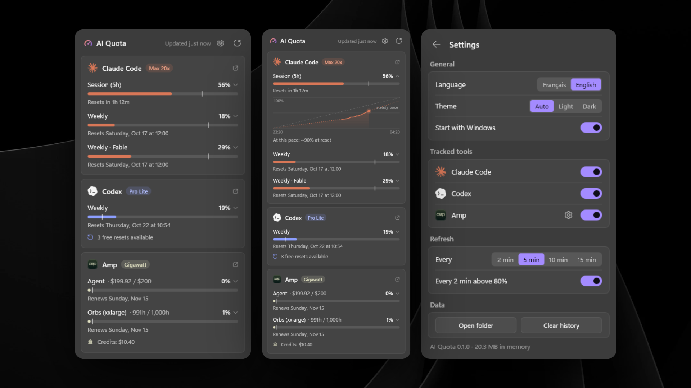

# AI Quota

A Windows tray app that shows your **Claude Code**, **Codex**, and **Amp** usage limits. Click the tray icon to open a Windows 11 flyout.



## Features

- Session, weekly, and per-model limits, each with its reset time.
- A pace marker on every bar. It shows where you would be if you used the window evenly. A bar past the marker means you are burning too fast.
- Click a limit to expand its chart: recorded usage, the steady-pace line, and a projection of the recent rate to the reset.
- Free resets you have banked (Claude and Codex).
- Amp: Agent budget in dollars, Orb hours, Amp Free, and credits.
- Settings: English or French, light, dark, or system theme, start with Windows, tracked tools, refresh interval.
- Keys: `R` or `F5` refreshes. `Esc` goes back or closes.

## Build

```powershell
cargo build --release
.\target\release\ai-quota.exe
```

Pass `--open` to open the flyout on launch. Starting the exe again while it runs opens the flyout of the running instance.

Windows 11 hides new tray icons under the `^` overflow. To keep the icon visible, drag it onto the taskbar.

## Set up the tools

Claude Code and Codex need no setup. The app reads the credentials their CLIs already saved.

To track Amp:

1. Create an access token in your Amp settings and copy it.
2. In the flyout, open **Settings**, then select the gear next to **Amp**.
3. Select **Paste**.

The app also reads `AMP_API_KEY` when it is set.

## Data sources

| Tool | Credentials | Endpoint |
|---|---|---|
| Claude Code | `%USERPROFILE%\.claude\.credentials.json` | `GET api.anthropic.com/api/oauth/usage` |
| Codex | `%USERPROFILE%\.codex\auth.json` | `GET chatgpt.com/backend-api/wham/usage` |
| Amp | Pasted token or `AMP_API_KEY` | `POST ampcode.com/api/internal?userDisplayBalanceInfo` |

These endpoints are not documented and can change. They report usage for the whole account, so cloud tasks count too.

The app never starts a CLI. Each refresh is one HTTPS request per tool, made with WinHTTP, and HTTP redirects are refused.

`CLAUDE_CONFIG_DIR` and `CODEX_HOME` are respected.

### Claude token refresh

Claude Code refreshes its token while it runs. Once the token has expired, the app refreshes it the way CodexBar does and writes back only `accessToken`, `refreshToken`, and `expiresAt`. If Claude Code refreshed in the meantime, its token wins.

### Rate limits and outages

After a `429`, the app waits at least 5 minutes, or longer if `Retry-After` says so. The pause survives restarts. A manual refresh skips it.

During a pause, an outage, or a `5xx`, the flyout shows the last good response, up to 12 hours old, with its age.

### Amp text format

The Amp endpoint returns display text, not structured data. The app parses it with the patterns CodexBar uses. It also accepts any `a1.*` Orb size, because the Gigawatt plan counts Orb hours in `a1.xxlarge`.

## Resource use

Measured on the release build:

| | Value |
|---|---|
| Binary | ~510 KB |
| Working set at idle | < 1 MB |
| Private memory at idle | ~4.5 MB |
| Private memory with the flyout open | ~8–20 MB |
| CPU at idle | 0 |

The flyout is drawn with Direct2D in software, so no GPU driver loads into the process. It is created on click and destroyed on close, and the app then returns its memory to Windows.

Polling runs every 5 minutes by default, or every 2 minutes above 80 %. It keeps running while the session is locked, so the history sees cloud tasks.

## Stored files

Everything lives in `%LOCALAPPDATA%\ai-quota`:

| File | Content |
|---|---|
| `history.tsv` | Usage samples for the charts, kept 8 days |
| `claude.json`, `codex.json`, `amp.json` | Last good response of each endpoint |
| `*.cooldown` | End of the pause after a `429` |
| `settings.json` | Settings |
| `amp.token` | Amp token, encrypted with DPAPI |

**Start with Windows** writes the `AI Quota` value under `HKCU\Software\Microsoft\Windows\CurrentVersion\Run`.

## Code layout

| File | Role |
|---|---|
| `src/main.rs` | Hidden window, message loop, timers, app state |
| `src/tray.rs` | Tray icon, tooltip, context menu |
| `src/popup.rs` | Flyout window, layout, Direct2D drawing, settings views |
| `src/providers.rs` | Claude Code, Codex, and Amp fetching and parsing |
| `src/history.rs` | Usage samples and the pace projection |
| `src/settings.rs` | Settings file |
| `src/secret.rs` | DPAPI encryption and clipboard |
| `src/http.rs` | HTTPS over WinHTTP |
| `src/i18n.rs`, `src/timefmt.rs` | English and French strings, dates |
| `src/svgpath.rs`, `src/logos.rs` | SVG path parser and provider logos |
| `src/art.rs`, `build.rs` | App icon drawn in code, embedded manifest |

Logos come from [Simple Icons](https://simpleicons.org) (CC0), [Lobe Icons](https://github.com/lobehub/lobe-icons) (MIT), and the [Amp press kit](https://ampcode.com/press-kit).
